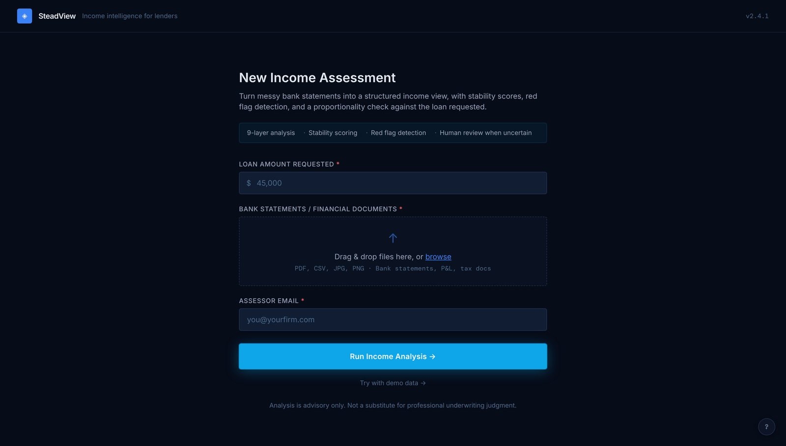
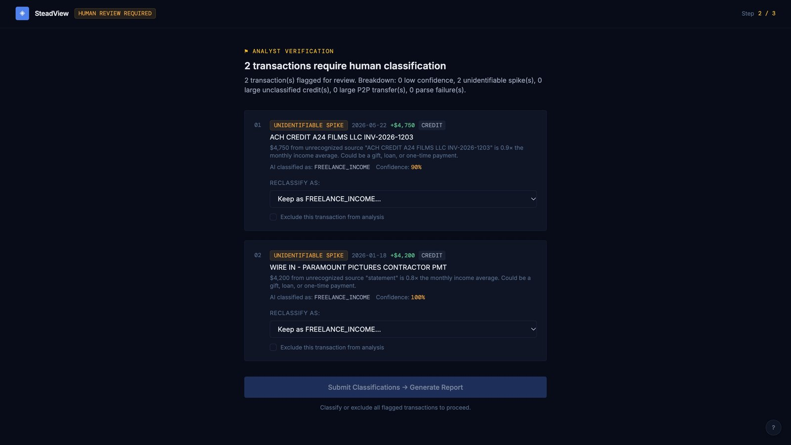
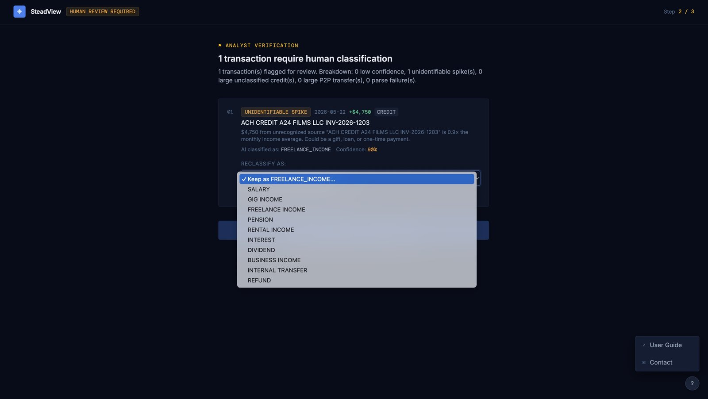
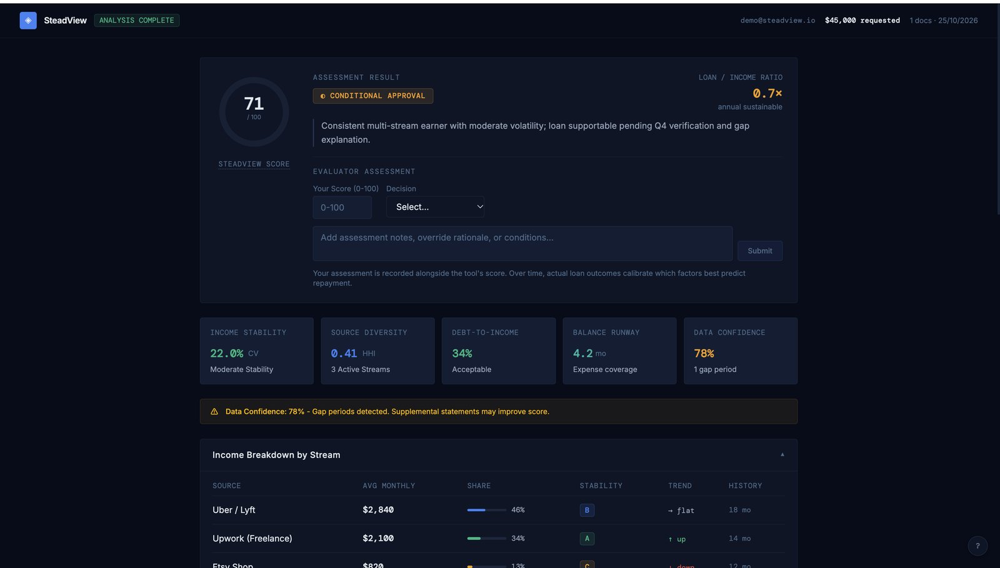

# SteadView

**Income intelligence for lenders.** SteadView reads a gig worker's bank statements, pulls out every transaction, classifies income and expenses, and turns them into a stability score, red flags and a loan-to-income check that an underwriter can act on in minutes instead of hours.

**Live demo:** https://steadview.netlify.app/



> AI extracts and classifies. Math computes. Humans decide.

For the full product story (why it exists, how each metric is calculated, known limitations and references), see [docs/PRODUCT.md](docs/PRODUCT.md).

---

## Contents

- [How it works](#how-it-works)
- [Screenshots](#screenshots)
- [Tech stack](#tech-stack)
- [Run it locally](#run-it-locally)
  - [Option A: frontend only, with demo data](#option-a-frontend-only-with-demo-data)
  - [Option B: full pipeline with n8n and Gemini](#option-b-full-pipeline-with-n8n-and-gemini)
- [Test data](#test-data)
- [Environment variables](#environment-variables)
- [Project structure](#project-structure)
- [Troubleshooting](#troubleshooting)

---

## How it works

1. **Intake.** The underwriter enters the loan amount and their email, and uploads bank statements (PDF).
2. **AI pipeline (n8n + Gemini).** Each document is classified (bank statement or not), then every transaction is extracted and categorised as salary, gig, freelance, rental, transfer, refund, and so on.
3. **Human review.** Transactions the pipeline isn't sure about (low confidence, unexplained spikes, large P2P transfers) are sent back to the underwriter to confirm or reclassify.
4. **Analytics.** A deterministic JavaScript engine computes income stability (CV), source diversity (HHI), DTI, balance runway, data confidence, red flags and the 0 to 100 SteadView Score.
5. **Report.** The underwriter sees the assessment, records their own score and decision, and adds notes.

## Screenshots

**1. Intake:** loan amount, statements and assessor email.


**2. Human review:** transactions the AI flagged are sent to the underwriter.



**3. Reclassify:** the underwriter can keep the AI's label, pick another category, or exclude the transaction.



**4. Assessment report:** SteadView Score, verdict, metric cards, income breakdown and evaluator input.



## Tech stack

| Layer | Technology |
|---|---|
| Frontend | React 19, TypeScript, Vite 8, Tailwind CSS 4, Recharts |
| Backend / orchestration | [n8n](https://n8n.io) workflow (`n8n/IncomeFlowAnalyser.json`) |
| AI | Google Gemini (`gemini-3.1-flash-lite`) via n8n's Google Gemini node |
| Analytics | Plain JavaScript inside n8n Code nodes (no AI in the scoring) |
| Hosting | Netlify (frontend), n8n Cloud (backend) |

---

## Run it locally

### Prerequisites

- **Node.js 20.19+ or 22.12+** (required by Vite 8) and npm
- **Git**
- For the full pipeline only:
  - An **n8n** instance: a free [n8n Cloud](https://n8n.io/cloud/) account, or self-hosted with `npx n8n` / Docker
  - A **Google Gemini API key** from [Google AI Studio](https://aistudio.google.com/app/apikey)

### Option A: frontend only, with demo data

This is the fastest way to see the app. No API keys needed.

```bash
git clone https://github.com/hsgarg/SteadView.git
cd SteadView
npm install
npm run dev
```

Open **http://localhost:8443** and click **"Try with demo data →"** under the Run button. You'll land on a full sample report built from mock data in `src/App.tsx`.

### Option B: full pipeline with n8n and Gemini

#### 1. Import the workflow into n8n

1. In n8n, go to **Workflows → Import from File** and pick [`n8n/IncomeFlowAnalyser.json`](n8n/IncomeFlowAnalyser.json).
2. Create a credential: **Credentials → Add credential → Google Gemini (PaLM) API**, and paste your Gemini API key.
3. Open the two Gemini nodes, **`classify_bankStatements`** and **`extrac_and_classify_itIndividualEntries`**, and select the credential you just created (the file ships with a placeholder credential id).
4. **Save** and **activate** the workflow (toggle in the top right). The app calls the production URL, which only responds while the workflow is active.
5. Open the **Webhook** node and copy its **Production URL**. It looks like:
   `https://<your-instance>.app.n8n.cloud/webhook/steadview`

#### 2. Configure the frontend

```bash
cp .env.example .env
```

Edit `.env`:

```bash
VITE_N8N_WEBHOOK_URL=https://<your-instance>.app.n8n.cloud/webhook/steadview
VITE_N8N_HOST=https://<your-instance>.app.n8n.cloud
```

For self-hosted n8n on the same machine, use `http://localhost:5678` as the host.

#### 3. Start the dev server

`vite.config.ts` reads `VITE_N8N_HOST` from the **shell environment** (Vite doesn't load `.env` into the config file), so export it before starting:

```bash
# macOS / Linux
export VITE_N8N_HOST=https://<your-instance>.app.n8n.cloud
npm run dev
```

```powershell
# Windows PowerShell
$env:VITE_N8N_HOST="https://<your-instance>.app.n8n.cloud"
npm run dev
```

The dev server runs on **http://localhost:8443** and proxies `/webhook` and `/webhook-waiting` to your n8n host. The `/webhook-waiting` proxy is what lets the **human review** step send its answers back to the paused n8n workflow, so that step only works through `npm run dev` (or a host with an equivalent proxy rule).

#### 4. Try it

Upload one or more statements from the [test data](#test-data), enter a loan amount and an email, and click **Run Income Analysis**. Extraction takes a minute or two. If anything needs a human decision you'll see the review screen, then the final report.

### Build for production

```bash
npm run build     # outputs to dist/
npm run preview   # serves the build locally
```

---

## Test data

Sample bank statements (January to June 2026, PDF) live in the companion repo:

**https://github.com/hsgarg/SteadView-Loan-underwriting-for-gig-workers/tree/main/test-data**

Upload all six for the most complete analysis; fewer months lowers the Data Confidence score.

## Environment variables

| Variable | Used by | Description |
|---|---|---|
| `VITE_N8N_WEBHOOK_URL` | Browser (`src/App.tsx`) | Full URL of the n8n Webhook node that receives the upload. Read from `.env` at build time. |
| `VITE_N8N_HOST` | Dev server proxy (`vite.config.ts`) | Base URL of your n8n instance. Must be set in the shell environment when running `npm run dev`. |

The Gemini API key is **not** a frontend variable. It lives only in the n8n credential, so it never reaches the browser.

## Project structure

```
SteadView/
├── src/
│   ├── App.tsx          # All screens: intake, human review, report (plus demo data)
│   ├── main.tsx         # React entry point
│   └── index.css        # Tailwind + theme
├── n8n/
│   └── IncomeFlowAnalyser.json   # Backend workflow to import into n8n
├── docs/
│   ├── PRODUCT.md       # Product rationale, metrics and references
│   └── screenshots/
├── .env.example
├── vite.config.ts       # Dev server on :8443 + n8n proxy
└── package.json
```

## Troubleshooting

| Symptom | Likely cause and fix |
|---|---|
| The report shows the sample numbers (and the "Maria Chen" narrative) after uploading real files | The call to n8n failed and the app fell back to demo data. Check the browser console, confirm the workflow is **active**, and that `VITE_N8N_WEBHOOK_URL` is the **production** URL (`/webhook/`, not `/webhook-test/`). Restart `npm run dev` after editing `.env`. |
| CORS error on the first upload | Set `VITE_N8N_WEBHOOK_URL=/webhook/steadview` so the request goes through the dev proxy instead of straight to n8n. |
| Human review "Submit" fails or hangs | `VITE_N8N_HOST` wasn't exported in the shell, so the `/webhook-waiting` proxy points at the placeholder host. Export it and restart the dev server. |
| n8n error in a Gemini node | The credential isn't selected on that node, or the API key is invalid or out of quota. |
| `npm run dev` errors about Node version | Upgrade to Node 20.19+ or 22.12+. |
